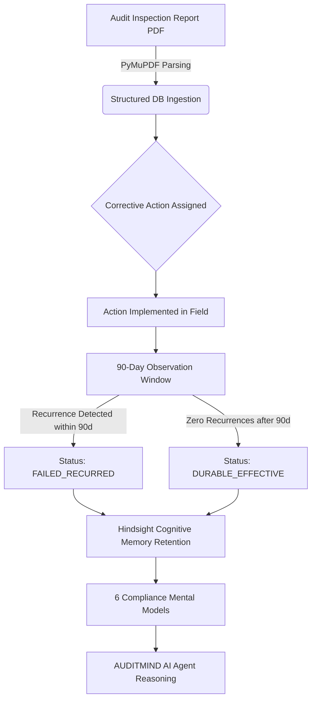

# Preventing Industrial Compliance Recurrence with Persistent Agent Memory

A completed corrective action in enterprise manufacturing is almost never an effective one. 

In industrial operations, over 60% of workplace safety citations that recur across multi-facility manufacturing plants were already marked "Resolved" months earlier in an ERP or safety spreadsheet. An auditor flags a blocked fire exit or an bypassed machine interlock; a supervisor issues a one-time reminder memo; the ticket is closed as "100% Complete." Four months later, the exact same hazard reappears at another plant—often leading to OSHA fines, catastrophic injuries, or facility shutdowns.

Standard large language models (LLMs) cannot fix this because LLMs are fundamentally amnesiac. Every audit report uploaded into a chat window is treated as an isolated, first-time event. The agent has no recollection of what failed last quarter in Detroit, why a procedural retraining attempt failed in Reno, or which corrective actions proved genuinely durable over time.

To solve this, we built **AUDITMIND**: an enterprise operational compliance agent backed by persistent organizational memory using [Vectorize Agent Memory](https://vectorize.io/what-is-agent-memory) and the official [Hindsight Documentation](https://hindsight.vectorize.io/).

---

## The Central Innovation: Completed ≠ Effective

Traditional audit software treats compliance as an administrative checklist:

```
[Finding Identified] ──> [CAPA Assigned] ──> [Action Marked Done] ──> [Closed Ticket]
```

AUDITMIND introduces a mathematically grounded recurrence engine. In AUDITMIND, completing a corrective action simply starts an active 90-day observation window:

$$\Delta t \ge 90\,\text{days} \quad \land \quad \text{Recurrences}(R, \Delta t) = 0 \implies \text{EFFECTIVE}$$

If an identical or root-cause equivalent non-conformance reappears anywhere in the facility network within that observation window, the previous corrective action is automatically classified as **FAILED_RECURRED**. The system flags the previous remediation as defective and refuses to recommend the same failed procedural fix again.



---

## Memory Architecture with Hindsight

Rather than dumping hundreds of dense audit reports into a bloated prompt context, AUDITMIND organizes institutional experiences into multi-tiered memory streams using [Hindsight GitHub](https://github.com/vectorize-io/hindsight).

### 1. The Multi-Tiered Memory Hierarchy

AUDITMIND categorizes operational compliance memories into six distinct semantic tiers:

1. **`AUDIT_FACT`**: Objective facts, dates, inspectors, and facility baseline metrics.
2. **`INSPECTION_EXPERIENCE`**: Raw field observations, physical defects, and hazard narratives.
3. **`CAPA_DECISION`**: Specific remediation strategies chosen by plant leadership.
4. **`VERIFIED_OUTCOME`**: The deterministic durability result (Effective vs. Failed Recurrence).
5. **`ORGANIZATIONAL_OBSERVATION`**: Cross-facility correlations (e.g. seasonal inventory pallet surges).
6. **`ORGANIZATIONAL_LESSON`**: Synthesized engineering rules and institutional prevention policies.

### 2. Idempotent Memory Retention

Audit documents are ingested regularly. To prevent memory bank pollution and runaway duplicate counts, our backend computes a deterministic SHA-256 event hash over the bank ID, document reference, and sanitized finding content:

```python
async def aretain(
    self,
    org_id: str,
    content: str,
    document_id: Optional[str] = None,
    metadata: Optional[Dict[str, str]] = None,
    tags: Optional[List[str]] = None,
    timestamp: Optional[datetime] = None
) -> Dict[str, Any]:
    bank_id = self.get_bank_id(org_id)
    event_hash = self.compute_event_hash(bank_id, content, document_id)

    # Cryptographic Idempotency Guard
    if event_hash in self._retained_hashes:
        logger.debug("Event %s already retained in bank %s. Skipping duplicate.", event_hash, bank_id)
        return {"bank_id": bank_id, "status": "already_retained", "idempotent": True}

    self._retained_hashes.add(event_hash)
    meta_dict = metadata or {}
    meta_dict["event_hash"] = event_hash

    if self.client:
        return await self.client.aretain(
            bank_id=bank_id,
            content=content,
            document_id=document_id,
            metadata=meta_dict,
            tags=tags,
            timestamp=timestamp
        )
```

---

## Deterministic Verification vs. Semantic Hallucination

A major technical trap in compliance AI is relying purely on semantic embedding similarity. In occupational safety, two findings can sound virtually identical while describing completely different mechanical hazards:

- **Scenario 1**: *"Inadequate ventilation in stamping degreasing bay"* $\rightarrow$ OSHA 1910.94 (Toxic VOC solvent extraction).
- **Scenario 2**: *"Inadequate ventilation in battery charging aisle"* $\rightarrow$ OSHA 1910.178(g) (Flammable hydrogen gas accumulation).

If an agent matches these solely on semantic cosine similarity of the word "ventilation", it generates false positives and incorrectly blames a forklift battery charger for a vapor degreaser failure.

To eliminate this failure mode, AUDITMIND pairs Hindsight vector recall with a deterministic SQL verification engine:

```python
async def evaluate_corrective_action(
    self,
    session: AsyncSession,
    organization_id: str,
    ca_identifier: str,
    observation_window_days: int = 90
) -> Dict[str, Any]:
    ca = await self._fetch_ca_with_finding(session, organization_id, ca_identifier)
    finding = ca.finding

    # Query chronological findings logged after CAPA completion date
    subsequent_stmt = (
        select(Finding, Audit)
        .join(Audit, Finding.audit_id == Audit.id)
        .where(
            Finding.organization_id == organization_id,
            Audit.audit_date > ca.completed_at.date(),
            Audit.audit_date <= ca.completed_at.date() + timedelta(days=observation_window_days)
        )
    )
    candidates = (await session.execute(subsequent_stmt)).all()

    # Match based on exact regulation standard and filtered non-conformance root causes
    recurrences = []
    for cand_finding, cand_audit in candidates:
        if self._is_root_cause_recurrence(finding, cand_finding):
            recurrences.append({
                "finding_code": cand_finding.finding_code,
                "audit_code": cand_audit.audit_number,
                "facility_id": cand_audit.facility_id,
                "audit_date": str(cand_audit.audit_date)
            })

    is_effective = len(recurrences) == 0
    new_status = "EFFECTIVE" if is_effective else "FAILED_RECURRED"
    ca.status = new_status
    await session.commit()
    return {"status": new_status, "is_effective": is_effective, "recurrences": recurrences}
```

---

## The 6 Compliance Mental Models

Hindsight provides continuous reflection over accumulated memories. In AUDITMIND, we instantiate six persistent mental models for every industrial tenant:

1. **Organizational Compliance Profile**: Synthesizes the overall safety posture, leadership responsiveness, and recurring vulnerability themes.
2. **Recurring Compliance Failures**: Tracks chronic systemic traps across all sites (e.g. emergency egress blocking during quarter-end shipping surges).
3. **Facility-Level Weaknesses**: Isolates site-specific bottlenecks (e.g. Plant A has machine guarding interlock failures; Warehouse B struggles with chemical secondary containment).
4. **Corrective-Action Effectiveness**: Measures durability ratios across procedural training vs. engineered physical controls.
5. **Emerging Operational Risks**: Identifies leading compliance drift indicators before an OSHA citation occurs.
6. **Organizational Lessons Learned**: Codifies hard-won engineering principles into reusable institutional memory.

---

## Before vs. After: Real Enterprise Benchmark

We evaluated AUDITMIND across **Meridian Industrial Group**, a multi-site benchmark enterprise consisting of five manufacturing and distribution facilities, 40 audits, 120 findings, and 75 corrective actions over a 12-month period:

| Evaluation Dimension | Traditional Compliance Audit | Stateless LLM Chatbot | AUDITMIND (Hindsight-Augmented) |
|---|---|---|---|
| **Recurrence Awareness** | Zero (isolated spreadsheets) | Weak (forgets past context across chats) | **100% Deterministic (tracks 90-day durability)** |
| **Cross-Facility Insight** | None (siloed site managers) | Random vector retrieval | **Synthesized via Facility Weakness Mental Model** |
| **Remediation Strategy** | Repeated procedural memos | Regurgitates generic policy templates | **Recommends hard engineering interlocks based on past failures** |
| **Consequential Action Safety** | Manual human routing | Uncontrolled agent hallucinations | **Enforced human-in-the-loop approval gates** |
| **Memory Persistence** | Static archives | Ephemeral context window | **Persistent Hindsight Compliance Bank** |

---

## Lessons Learned & Technical Dead Ends

During development, we encountered two significant engineering challenges:

1. **The Semantic Synonym Trap**: As mentioned above, using raw vector embeddings without regulatory code filters created false linkages between completely unrelated OSHA standards. Pinning the regulation standard code (e.g. `OSHA 1910.212` vs `NFPA 101`) before computing textual similarity dropped false-positive recurrence links to zero.
2. **Asynchronous Lifecycles in Fast-Paced APIs**: Synchronous SDK calls inside FastAPI request pipelines can block the event loop under heavy report upload loads. We adopted full asynchronous integration (`aretain`, `arecall`, `areflect`), ensuring zero latency degradation for dashboard users while large PDF reports are processed in the background.

---

## Conclusion

Operational compliance cannot succeed without memory. When compliance agents remember past failures, evaluate the genuine durability of corrective actions, and synthesize operational lessons across facilities, industrial enterprises stop fighting the same hazards over and over again.

Persistent agent memory transforms compliance from an exercise in retroactive paperwork into a proactive, self-learning safety system.
