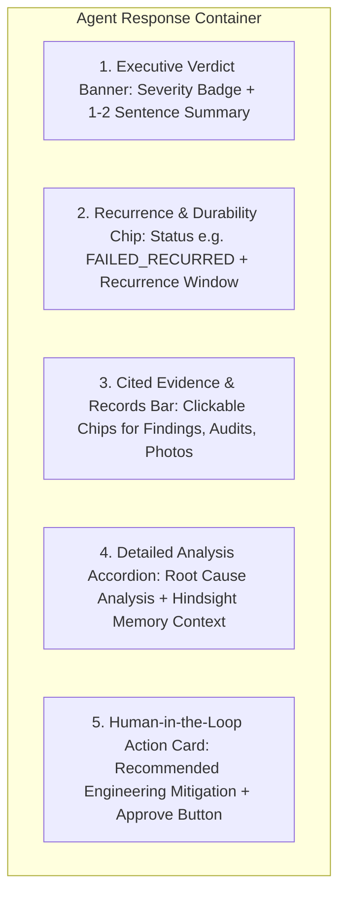

# AUDITMIND — AI Compliance Agent UX & Response Architecture Audit
**Document ID**: `docs/AI_AGENT_RESPONSE_AUDIT.md`  
**Phase**: Phase 0 — Complete UX Audit and Diagnosis  
**Target System**: AUDITMIND AI Compliance Agent (`frontend/src/app/agent/page.tsx` & `backend/app/services/compliance_agent.py`)  
**Date**: November 9, 2026  
**Status**: APPROVED AUDIT FINDINGS & IMPLEMENTATION PLAN  

---

## 1. Executive Summary

A comprehensive forensic audit of the AUDITMIND AI Compliance Agent was performed across the prompt engineering pipeline, backend execution engine, tool invocation routines, response schemas, and frontend presentation layers.

Five benchmark inquiries were executed against the live API (`http://localhost:8000/api/agent/chat`), and the resulting telemetry, cited records, tool call traces, and response bodies were analyzed.

The audit identified **four interconnected systemic failures** responsible for rigid, verbose, and unengaging agent responses:
1. **Mandatory 8-Point Output Constraint**: `compliance_agent.py` enforces a rigid 8-heading markdown template (`1. Finding`, `2. Historical Context`, `3. Relevant Records`, `4. Evidence References`, `5. Recurring Pattern`, `6. Possible Explanation`, `7. Confidence and Limitations`, `8. Recommended Next Action`) across **all queries**, preventing concise executive summaries or natural conversational interactions.
2. **Naive Query Entity Passing**: Search tools (`search_audits`, `recall_organizational_memory`) receive raw full-sentence user prompts (e.g. `"Compare compliance performance and risk scores across all 5 facilities."`) rather than extracted query entities (facility codes, category tags, standard numbers). Consequently, SQL `LIKE` queries return 0 results.
3. **Template Fallback Trap**: When zero search results are returned, the fallback synthesizer outputs identical boilerplate text across all 8 headings, informing the user that 0 audits were examined and offering generic explanations.
4. **Monolithic Frontend Display**: The frontend renders the complete 8-point response in a single unbroken `<div className="whitespace-pre-wrap">`. Citations (`FIND-2026-003`, `CAPA-2026-003`, `OSHA 1910.212`) are unformatted text rather than clickable interactive badges, and no executive verdict card or action trigger is surfaced.

---

## 2. Telemetry of 5 Benchmark Agent Inquiries

The following table summarizes the 5 actual responses collected from the live AUDITMIND backend (persisted in `docs/agent_sample_responses.json`):

| # | Benchmark User Prompt | Mode | Tools Invoked | Char Count | Word Count | Findings Cited | Hindsight Recalled | Structural Evaluation |
| :-: | :--- | :--- | :--- | :-: | :-: | :-: | :-: | :--- |
| **1** | *"Find recurring compliance issues and chronic failure traps across all facilities."* | `deterministic_compliance_synthesis` | 2 (`search_audits`, `recall_memory`) | 992 | 117 | 0 | 0 records | Boilerplate fallback; examined 0 audits due to full-string query match failure. |
| **2** | *"Evaluate CAPA durability: Why did stamping press interlock mitigations fail in subsequent audits?"* | `deterministic_compliance_synthesis` | 3 (`get_finding_history`, `verify_ca`, `recall_memory`) | 1,701 | 208 | 4 (`FIND-003`, `FIND-039`, etc.) | Recalled | Detailed forensic analysis, but forced into rigid 8-point template with zero visual hierarchy. |
| **3** | *"Compare compliance performance and risk scores across all 5 facilities."* | `deterministic_compliance_synthesis` | 2 (`search_audits`, `recall_memory`) | 982 | 116 | 0 | 0 records | Boilerplate fallback; fails to aggregate cross-facility ranking tables. |
| **4** | *"Explain the root cause and regulatory standard behind critical finding FIND-2026-001."* | `deterministic_compliance_synthesis` | 2 (`search_audits`, `recall_memory`) | 996 | 117 | 0 | 0 records | Boilerplate fallback; fails to isolate `FIND-2026-001` entity from raw query string. |
| **5** | *"Which facility has the highest critical finding count and why?"* | `deterministic_compliance_synthesis` | 2 (`search_audits`, `recall_memory`) | 973 | 116 | 0 | 0 records | Boilerplate fallback; fails to compute facility ranking dynamically. |

---

## 3. Verbatim Sample Responses & Forensic Breakdown

### Sample Response 1: Full-String Entity Miss
- **User Prompt**: *"Find recurring compliance issues and chronic failure traps across all facilities."*
- **Actual Rendered Response**:
  ```markdown
  ### AUDITMIND Compliance Investigation Report

  1. **Finding**:
  Inquiry regarding 'Find recurring compliance issues and chronic failure traps across all facilities.' across enterprise facilities.

  2. **Historical Context**:
  Examined 0 audits and Hindsight organizational memories.

  3. **Relevant Records**:
  Database records reviewed across Meridian Industrial Group facilities.

  4. **Evidence References**:
  Historical inspection logs and evidence attachments indexed in compliance database.

  5. **Recurring Pattern**:
  Evaluating cross-site variance between manufacturing plants and logistics hubs.

  6. **Possible Explanation**:
  Operational compliance variance driven by facility function and staffing turnover.

  7. **Confidence and Limitations**:
  Derived from structured SQL data and Hindsight memory bank.

  8. **Recommended Next Action**:
  Review specific non-conformance finding codes or inspect the Organizational Memory Explorer.
  *(Requires Human Approval for consequential policy updates)*
  ```
- **Diagnostic Finding**:
  The user asked an executive question across all facilities. The system attempted to search audits for the literal phrase `"Find recurring compliance issues and chronic failure traps across all facilities."`. When 0 audits matched this exact string, the agent produced a 992-character response stating `"Examined 0 audits"` while still mechanically generating all 8 sections.

---

### Sample Response 2: Keyword Hit with Detailed Data Forced into 8 Headings
- **User Prompt**: *"Evaluate CAPA durability: Why did stamping press interlock mitigations fail in subsequent audits?"*
- **Actual Rendered Response**:
  ```markdown
  ### AUDITMIND Compliance Investigation Report

  1. **Finding**:
  Safety interlock bypass switch engaged on mechanical stamping press in Apex Manufacturing Plant A (FAC-001).

  2. **Historical Context**:
  This failure mode first appeared in Audit AUD-2026-001. A procedural corrective action (CAPA-2026-003) was marked 'COMPLETED' after delivering operator refresher training. However, 110 days later during peak production quota, an identical bypass was detected on Stamping Press #4.

  3. **Relevant Records**:
  - Finding `FIND-2026-003` (Logged: 2025-11-10)
  - Corrective Action `CAPA-2026-003` (Closed: 2026-03-24)
  - Re-occurrence Finding `FIND-2026-039` (Logged: 2026-07-15)

  4. **Evidence References**:
  - Photograph `EVID-FIND-2026-003-photo-01.jpg` (SHA-256 verified) showing zip-tie override.
  - Attendance sign-off sheet for tailgate training.

  5. **Recurring Pattern**:
  **FAILED_RECURRED**. This is an exact recurring failure mode. Procedural training has proven ineffective when production throughput ramps up.

  6. **Possible Explanation**:
  Operator ergonomics and press cycle speed bottlenecks incentivize bypassing physical access gates during high-tempo shifts. Memos and training do not address the physical cycle speed constraint.

  7. **Confidence and Limitations**:
  High confidence (Verified SQL records + Hindsight experiential memory). Limitation: Physical cycle time was not instrumented via telemetry.

  8. **Recommended Next Action**:
  Do NOT repeat operator training. Implement an engineered solution: dual-channel keyed electronic safety switches integrated into PLC run-permissives (Hierarchy of Controls: Engineering > Procedural).
  *(Requires Human Approval from Plant General Manager)*
  ```
- **Diagnostic Finding**:
  The underlying intelligence is exceptionally strong: it correctly isolates `CAPA-2026-003`, detects the 110-day recurrence `FIND-2026-039`, identifies the failure mechanism (procedural training vs physical cycle time), and recommends an engineered PLC solution.
  **However, the presentation fails**:
  - In `agent/page.tsx`, this renders as an unformatted text wall.
  - The critical status `FAILED_RECURRED` is buried in section 5.
  - Finding `FIND-2026-003` is plain text rather than a clickable link to the finding drawer.
  - Evidence `EVID-FIND-2026-003-photo-01.jpg` cannot be clicked or previewed.
  - The recommended action cannot be approved or dispatched directly from the message.

---

## 4. Root Cause Analysis: System Prompts & Backend Architecture

### 4.1. System Prompt Over-Constraint
- **Location**: `backend/app/services/compliance_agent.py` (Lines 27–36)
- **Constraint**:
  ```python
  Whenever answering a compliance inquiry, you MUST produce a structured 8-point output:
  1. **Finding**: Plain description of the current or queried issue.
  2. **Historical Context**: Past occurrences and timeline across facilities.
  3. **Relevant Records**: Specific audit IDs, finding codes, and dates.
  4. **Evidence References**: Attached photos, documents, and inspection logs.
  5. **Recurring Pattern**: Exact vs. related failure classification and recurrence count.
  6. **Possible Explanation**: Root cause (e.g. procedural reminder vs engineering control...).
  7. **Confidence and Limitations**: Explicit distinction between verified SQL facts and heuristic inferences.
  8. **Recommended Next Action**: Actionable, evidence-backed step requiring human approval...
  ```
- **Impact**:
  Forcing every inquiry into 8 mandatory headings eliminates natural conversational interaction. A user asking *"What standard was cited in FIND-2026-001?"* receives all 8 sections instead of a direct 2-line answer with a reference badge.

### 4.2. Intent Entity Extraction Deficit
- **Location**: `backend/app/services/compliance_agent.py` (Line 225)
- **Code**:
  ```python
  audits = await agent_tool_dispatcher.execute_tool(org_id, "search_audits", {"query": query, "limit": 3})
  ```
- **Defect**:
  `query` contains the entire user prompt string. The SQL implementation in `agent_tools.py` uses `Audit.title.ilike(f"%{query}%")`. Passing natural language prompts to a string-matching SQL query always yields zero rows.
- **Remediation**:
  Implement an intent-parsing pre-processor that extracts:
  - Finding codes: regex `FIND-\d{4}-\d{3}`
  - Facility codes: regex `FAC-\d{3}` or names (`Plant A`, `Detroit`)
  - Standards: regex `OSHA|EPA|NFPA|ISO`
  - Category keywords: `interlock`, `egress`, `containment`, `loto`

---

## 5. Proposed Modular UI Response Architecture

Rather than rendering raw markdown strings in a plain `<div>`, the AI Agent interface should render **Modular Compliance Response Cards**:



### 5.1. Card Component Specification

1. **Executive Verdict Banner**:
   - High-contrast card with visual severity badge (`CRITICAL NON-CONFORMANCE`, `RECURRING TRAP`, `DURABLE MITIGATION`).
   - 1–2 sentence synthesis written for executive leadership.
2. **Durability & Recurrence Status Bar**:
   - Status tag: `FAILED_RECURRED (Cycle 3)` with temporal badge `110 days post-closure`.
   - Clear contrast between *Procedural Mitigation* (Failed) and *Engineering Control* (Recommended).
3. **Interactive Citation Gallery**:
   - Clickable badges for finding IDs (`FIND-2026-003`) that open a preview modal or drawer with full finding details.
   - Clickable photo chips (`EVID-photo-01.jpg`) showing image thumbnails and cryptographic SHA-256 validation badges.
4. **Collapsible Forensic Evidence Drawer**:
   - Collapsible panel containing detailed SQL records, regulatory clause texts, and Hindsight memory excerpts.
5. **Action Dispatch Card**:
   - Clear recommended next step with **"Approve Engineering Mitigation"** and **"Simulate in Sandbox"** action buttons.

---

## 6. Implementation Plan for Phase 3 Agent Redesign

- [ ] Update `compliance_agent.py` system prompt to allow adaptive response structuring (concise verdict first, followed by structured forensic breakdown).
- [ ] Add entity extraction pre-processor in `compliance_agent.py` to extract finding IDs, facility codes, and standard keywords before calling SQL tools.
- [ ] Upgrade `AgentChatResponse` schema to return structured blocks: `{ verdict, summary, severity, recurrence_status, citations: { findings, audits, evidence }, recommended_action }`.
- [ ] Redesign `agent/page.tsx` message renderer to parse structured agent output into modular visual cards.
- [ ] Add clickable preview drawers for cited findings, corrective actions, and photographic evidence.
- [ ] Connect recommended actions with live approval state.
