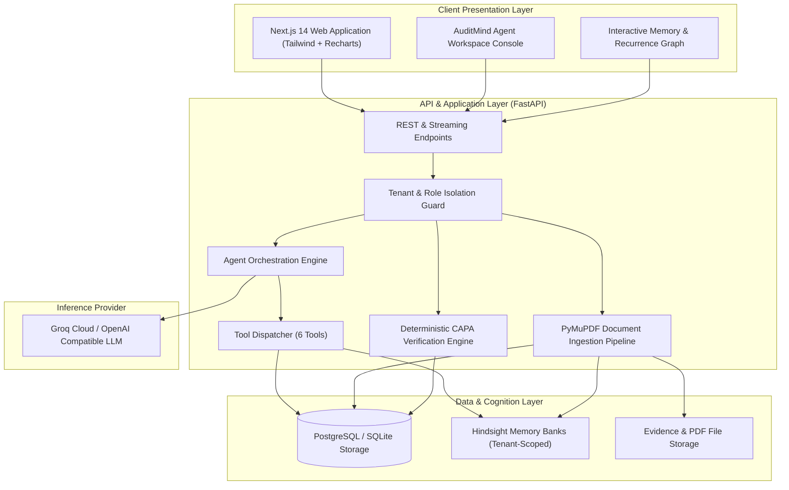

# AUDITMIND Architecture Specification

## 1. High-Level Architectural Principles

1. **Structured Source of Truth**: PostgreSQL serves as the immutable transactional authority for all entities (organizations, facilities, audits, findings, corrective actions, and verifications).
2. **Cognitive Memory Layer**: Hindsight acts as the persistent experiential memory bank, encoding historical patterns, cross-facility lessons, and compliance drift.
3. **Deterministic Verification**: No LLM ever asserts regulatory compliance independently. Compliance status transitions are evaluated via deterministic business rules validated against database state.
4. **Tenant Isolation**: Every database query, Hindsight bank partition, and API route is strictly scoped by `organization_id`.
5. **Human-in-the-Loop**: High-consequence actions (closing findings, certifying CAPAs, issuing enforcement penalties) require explicit authorized human confirmation.

---

## 2. Component Diagram

---

## 3. Technology Stack Justification

| Layer | Selection | Justification |
|---|---|---|
| **Frontend** | Next.js 14/15, TypeScript, Tailwind CSS, Lucide | Instant server-side rendering, type-safety, rapid dashboard iteration, responsive UI. |
| **Data Viz** | Recharts | Composable React charting for compliance drift trends, facility risk matrices, and recurrence heatmaps. |
| **Backend API** | Python 3.11, FastAPI, Pydantic v2 | High-throughput asynchronous endpoints, native OpenAPI schema generation, typed data contracts. |
| **ORM / Migrations** | SQLAlchemy 2.0 (AsyncIO), Alembic | Clean relational mapping, transaction safety, robust migration management. |
| **Document Processing** | PyMuPDF (fitz), pdfplumber | Blazing-fast PDF text and table extraction; accurate bounding-box and metadata parsing. |
| **Memory Engine** | Hindsight Python Client (`hindsight-client`) | Hierarchical memory retention, semantic and temporal recall, reflective mental model synthesis. |
| **LLM Provider** | Groq API / OpenAI Compatible (`groq`, `openai`) | Low latency tool calling and inference for real-time compliance investigation. |
