# AUDITMIND — Executive Dashboard Redesign Audit & Architecture
**Document ID**: `docs/DASHBOARD_REDESIGN_AUDIT.md`  
**Phase**: Phase 0 — Complete UX Audit and Diagnosis  
**Target View**: Executive Overview (`frontend/src/app/dashboard/page.tsx`)  
**Date**: November 9, 2026  
**Status**: APPROVED AUDIT FINDINGS & IMPLEMENTATION PLAN  

---

## 1. Executive Summary

A comprehensive architectural and visual UX audit of the AUDITMIND Executive Dashboard was conducted. The current dashboard functions as an analytical report, but suffers from **repetitive rectangular cards, uniform metric weight, static SVG visualizations, truncated categorical axes, and absent operational dispatch capabilities**.

To transform the dashboard into the **Cinematic Intelligence Command Center** demanded by the landing page visual identity, the dashboard must transition from a passive reporting screen to an **active operational surveillance workspace**.

---

## 2. Current State vs Target State Architecture

```mermaid
flowchart TD
    subgraph Current Architecture
        A1[Top Banner: Static Text & 2 Action Buttons] --> B1[KPI Strip: 6 Symmetrical Divided Boxes]
        B1 --> C1[Row 1: Static Recharts Bar Chart 7-col + 3 Text Cards 5-col]
        C1 --> D1[Row 2: Facility Risk List 6-col + CAPA 3-col Grid 6-col]
        D1 --> E1[Row 3: Linear Event Feed]
    end

    subgraph Proposed Command Center Architecture
        A2[Executive Command Strip: Live Operational Health Index + Active Regulatory Threats] --> B2[Asymmetric Strategic KPI Radar: Primary Risk Gauges vs Secondary Baseline Stats]
        B2 --> C2[Interactive Statutory Drift Topography: Multi-Facility SVG Drilldown + Recurrence Vector Scrubbing]
        C2 --> D2[Dynamic Cognitive Risk Sentinel: Hindsight Memory Alerts + 1-Click Forensic Dispatch to Agent]
        D2 --> E2[Enterprise Facility Matrix: Heat Map with Direct Facility Deep-Links + Verification Traps]
    end
```



---

## 3. Detailed Forensic Audit of Current Components

### 3.1. Top KPI Strip: Uniformity & Repetitive Card Syndrome
- **Current Layout**:
  A single container (`bg-[#101010] border border-white/10 rounded-2xl`) split into 6 uniform grid cells using Tailwind `divide-x divide-white/10`:
  1. `Monitored Sites`: 5
  2. `Statutory Audits`: 41
  3. `Open Deviations`: 47
  4. `Critical Exposures`: 23
  5. `Pending Verifications`: 32
  6. `Recurrence Velocity`: 22.9%
- **UX Deficiencies**:
  1. **Zero Hierarchical Differentiation**: A static count of monitored sites (5) occupies the exact same visual footprint and prominence as 23 active Critical Exposures.
  2. **Absence of Temporal Reference / Velocity Deltas**: None of the metrics display a period-over-period comparison indicator (e.g. `+3 vs Q3 2026` or `-4.2% failure velocity`).
  3. **Absence of Status Categorization**: All numbers are styled in uniform white font-mono text, with only a small red pulse dot on Critical Exposures.
- **Redesign Plan**:
  - Split KPIs into an **Asymmetric Primary vs Supporting Metric Hierarchy**:
    - **Tier 1 (High-Priority Threat Gauges)**:
      - *Systemic Recurrence Rate*: Large prominent gauge featuring lavender-to-peach gradient (`#C6B9D8` to `#D5A6B5`) with 90-day recurrence trap indicators.
      - *Active Statutory Exposures*: High-contrast card with breakdown of Critical vs Major regulatory non-conformances and OSHA/EPA liability.
      - *CAPA Durability Quotient*: Real empirical durability rate (e.g. 46.7%) prominently distinguished from procedural paper completion (60/60 closed).
    - **Tier 2 (Operational Inventory Strip)**:
      - Compact secondary row displaying Monitored Facilities (5), Audits Ingested (41), and OCR Evidences Processed (312) in refined, low-noise typography.

### 3.2. Statutory Concentration Matrix (Bar Chart)
- **Current Layout**:
  Recharts `BarChart` comparing `Total` findings (white) against `Recurring` findings (`#D5A6B5`) across 6 categories.
- **UX Deficiencies**:
  1. **Truncated Labels with Diagonal Glitch**: Categories longer than 13 characters are truncated (`item.category.substring(0, 13) + "..."`) and angled at `-15deg`. On 1366px and 1440px displays, labels like `Machine Safe...` and `Hazardous M...` fail to convey the cited regulation.
  2. **Static & Non-Interactive**: Clicking a bar does nothing. Users cannot filter the dashboard to see which specific facilities drive the Machine Safety or Egress spikes.
  3. **Single-Perspective Data**: Displays raw counts rather than recurrence severity ratios. A category with 3 critical recurrences is visually buried beneath a category with 15 minor paperwork infractions.
- **Redesign Plan**:
  - Replace the truncated X-axis with horizontal or multi-tiered interactive category bars with full regulatory citations (`OSHA 1910.212 Machine Guarding`, `NFPA 101 Life Safety / Egress`, `EPA 40 CFR Hazardous Waste`).
  - Add interactive hover state revealing:
    - Primary site affected (e.g. `Detroit Plant A: 68% of volume`).
    - Recurrence trap risk level (`HIGH - 3 repeated cycles post-training`).
    - Quick-filter button to immediately view findings in the finding explorer.

### 3.3. Cognitive Risk Detections (Hindsight Surveillance)
- **Current Layout**:
  A 5-column vertical card stack listing 3 static text cards: "Chronic Egress Compromise", "Ineffective Administrative Mitigation", and "Empirically Verified Durability".
- **UX Deficiencies**:
  1. **Lack of Dynamic Memory Linkage**: Cards are rendered from static templates rather than exposing live associative memory streams from Hindsight.
  2. **No Immediate Action Trigger**: Each card has a generic "Inspect finding" link, but no button to **"Dispatch Investigation to AI Agent"** with pre-populated forensic scope.
  3. **Visual Density**: The cards use small text (`text-[11px]`) with dark borders, making them look like secondary sidebars rather than high-order intelligence detections.
- **Redesign Plan**:
  - Redesign into a **Dynamic Cognitive Sentinel**:
    - Each detected failure mode displays an explicit **Failure Vector Tag** (`[PROCEDURAL_TRAP]`, `[CYCLICAL_RECURRENCE]`, `[CROSS_SITE_CONTAGION]`).
    - Prominent **"Investigate with Agent"** action button that directly opens `/agent?query=...` with the specific finding and facility pre-selected.
    - Clear timeline indicator showing days between mitigation and recurrence.

### 3.4. Facility Vulnerability Stratification
- **Current Layout**:
  List of 5 facilities sorted by risk score with a small 20px progress bar.
- **UX Deficiencies**:
  1. **Flat Linear Bars**: A simple white fill bar fails to communicate severity thresholds (e.g. green < 30, amber 30-50, critical > 50).
  2. **No Operational Context**: Fails to show facility type (Heavy Stamping vs Electronics vs Chemical Storage) or primary failure mode.
  3. **Disjointed Navigation**: Clicking a facility row does not open that facility's drilldown view.
- **Redesign Plan**:
  - Transform into an **Enterprise Facility Matrix**:
    - Status badge with color-coded risk tier (`CRITICAL RISK`, `ELEVATED`, `CONTROLLED`).
    - Primary vulnerability tags (e.g. `Machine Guarding • Detroit`, `Egress Obstruction • Reno`).
    - Direct 1-click drilldown into the facility's audit history and non-conformance ledger.

---

## 4. Proposed Layout & Visual Hierarchy Grid

```
+--------------------------------------------------------------------------------------------------+
| AUDITMIND COMMAND CENTER HEADER                                                                   |
| [Status: LIVE SURVEILLANCE]  •  [Tenant: Meridian Industrial Group]  •  [Sync Telemetry] [Ask AI] |
+--------------------------------------------------------------------------------------------------+
| TIER 1: STRATEGIC RISK RADAR (3-Column Asymmetric Gauges)                                        |
| +-----------------------------+ +-----------------------------+ +------------------------------+ |
| | SYSTEMIC RECURRENCE RATE    | | CRITICAL STATUTORY THREATS  | | EMPIRICAL CAPA DURABILITY    | |
| | 22.9%                       | | 23 Critical Non-Conformances| | 46.7%                        | |
| | +3.1% vs Q3 (Chronic Traps) | | OSHA & NFPA Violations      | | 53.3% Procedural Failures    | |
| +-----------------------------+ +-----------------------------+ +------------------------------+ |
+--------------------------------------------------------------------------------------------------+
| TIER 2: PRIMARY INTELLIGENCE COMPOSITION (7 Col / 5 Col Grid)                                    |
| +-------------------------------------------+ +------------------------------------------------+ |
| | REGULATORY DRIFT TOPOGRAPHY (7 Cols)       | | COGNITIVE RISK DETECTIONS (5 Cols)             | |
| | Interactive SVG Bar/Drift Matrix           | | [CHRONIC TRAP] Stamping Press Interlock Bypass | |
| | Full category labels & regulatory standards| | Plant A • 3 recurrence cycles post-training    | |
| | Real-time facility filter toggles          | | [-> Dispatch Investigation to AI Agent]       | |
| +-------------------------------------------+ +------------------------------------------------+ |
+--------------------------------------------------------------------------------------------------+
| TIER 3: OPERATIONAL TOPOLOGY & FACILITY RISK LEDGER                                              |
| +-------------------------------------------+ +------------------------------------------------+ |
| | FACILITY RISK STRATIFICATION MATRIX       | | DURABILITY TIMELINE & VERIFICATION GATE        | |
| | 5 Operating sites with severity tiers     | | 90-day stress window verification outcomes     | |
| +-------------------------------------------+ +------------------------------------------------+ |
+--------------------------------------------------------------------------------------------------+
```

---

## 5. Design Tokens & Styling Rules for Dashboard Redesign

1. **Background**: Deep cinematic base `#08080A` with subtle radial gradient spotlight `#121218`.
2. **Surface Panels**: `#0E0F14` with border `border-white/[0.08]` and subtle top highlight `shadow-[inset_0_1px_0_0_rgba(255,255,255,0.05)]`.
3. **Typography**:
   - Headers: `font-sans font-semibold tracking-[-0.02em] text-white`.
   - Category Eyebrows: `font-mono text-[10px] uppercase tracking-[0.14em] text-white/50`.
   - Metrics: `font-mono font-semibold tracking-tight text-white`.
   - Body & Descriptions: `font-sans text-xs sm:text-sm text-[#C8C8C8] leading-relaxed`.
4. **Cinematic Accents**:
   - Primary Accent: Lavender `#C6B9D8` (for intelligence, memory, and proactive verification).
   - Recurrence Warning: Dusty Pink `#D5A6B5` (for chronic loops and ineffective procedural mitigations).
   - Critical Liability: Crimson `#EF4444` / `#F87171` (for immediate statutory and life safety violations).
   - Verified Durability: Emerald `#10B981` / `#34D399` (for engineered permanent resolutions).

---

## 6. Implementation Plan for Phase 2 Redesign

- [ ] Structure `DashboardPage` into clear visual tiers (Strategic Radar, Regulatory Drift, Cognitive Sentinel, Facility Matrix).
- [ ] Implement differentiated KPI cards with temporal deltas and regulatory severity badges.
- [ ] Upgrade the Recharts bar chart with full category labels, regulatory standard badges, and interactive click handlers.
- [ ] Connect Cognitive Risk Detection cards with 1-click transition to `/agent` with pre-filled investigation prompt.
- [ ] Verify zero regressions on backend API integration (`api.getDashboardOverview`, `api.getDriftMatrix`).
- [ ] Ensure full responsive compliance across mobile (375px), laptop (1440px), and 4K desktop (2560px).
