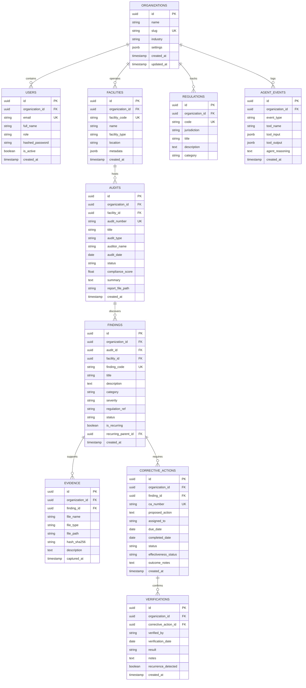

# AUDITMIND Database Schema & Entity Specification

## 1. Schema Overview

All transactional entities belong to the `public` schema and enforce organization-level scoping via `organization_id` foreign keys with appropriate cascade policies and indexes.

---

## 2. Table Specifications & Indexes

1. **organizations**:
   - Primary Key: `id` (UUID)
   - Unique: `slug`
2. **facilities**:
   - Foreign Key: `organization_id`
   - Unique: `facility_code`
   - Index on: `(organization_id, facility_type)`
3. **audits**:
   - Foreign Key: `facility_id`, `organization_id`
   - Indexes on: `(organization_id, audit_date)`, `(facility_id, status)`
4. **findings**:
   - Foreign Key: `audit_id`, `facility_id`, `organization_id`
   - Indexes on: `(organization_id, category)`, `(organization_id, severity)`, `(facility_id, is_recurring)`
5. **corrective_actions**:
   - Foreign Key: `finding_id`, `organization_id`
   - Indexes on: `(organization_id, effectiveness_status)`, `(finding_id)`
6. **verifications**:
   - Foreign Key: `corrective_action_id`, `organization_id`
   - Index on: `(corrective_action_id, verification_date)`
7. **agent_events**:
   - Foreign Key: `organization_id`
   - Index on: `(organization_id, created_at)`
