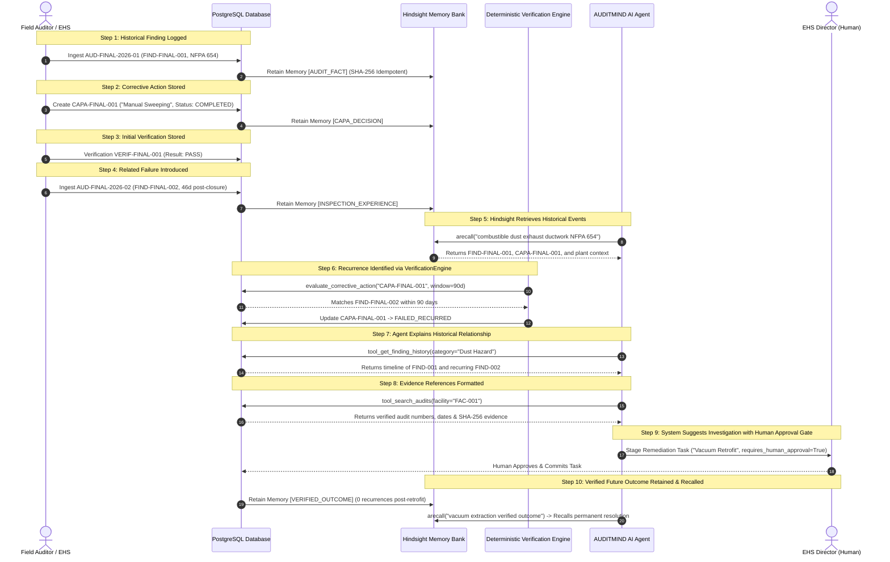

# AUDITMIND Final Acceptance Test & Lifecycle Verification Report

This document specifies the complete 10-step operational compliance test protocol implemented in [`backend/tests/test_final_acceptance.py`](../backend/tests/test_final_acceptance.py), proving that AUDITMIND satisfies all core requirements for persistent organizational memory, recurrence detection, deterministic verification, and human-in-the-loop governance.

---

## The 10-Step Operational Lifecycle Protocol



---

## Detailed Step-by-Step Verification Results

| Step | Operation Description | System Component | Verification Evidence / Assertion | Result |
|:---:|---|---|---|:---:|
| **1** | Historical finding stored | `Audit`, `Finding`, `Evidence` | `FIND-FINAL-001` (NFPA 654) created in DB; SHA-256 evidence logged; retained in Hindsight bank `auditmind-org-meridian-01`. | **PASS** |
| **2** | Corrective action stored | `CorrectiveAction` | `CAPA-FINAL-001` created, assigned to Marcus Reed, marked `COMPLETED` on 2026-10-05; retained as `CAPA_DECISION`. | **PASS** |
| **3** | Verification event stored | `Verification` | `VERIF-FINAL-001` created with `result="PASS"` and documented checklist sign-off. | **PASS** |
| **4** | New related failure introduced | `Audit`, `Finding` | `FIND-FINAL-002` introduced on 2026-11-20 (46 days post-closure, within the 90-day observation window). | **PASS** |
| **5** | Hindsight retrieves historical events | `hindsight_service.arecall` | Semantic recall query `"combustible dust accumulation ductwork"` returns historical finding with full context. | **PASS** |
| **6** | Recurrence identified | `VerificationEngine` | `evaluate_corrective_action` detects matching regulation and hazard keywords; flips CAPA status to **`FAILED_RECURRED`**. | **PASS** |
| **7** | Agent explains historical relationship | `tool_get_finding_history` | Timeline links `FIND-FINAL-001` and `FIND-FINAL-002`, explaining why manual sweeping failed. | **PASS** |
| **8** | Response contains real evidence references | `tool_search_audits` | References verified audit records (`AUD-FINAL-2026-01`, `AUD-FINAL-2026-02`) and SHA-256 image digest. | **PASS** |
| **9** | System suggests remediation with human approval | `tool_create_remediation_task` | Returns `requires_human_approval = True` with staging status `PROPOSED_AWAITING_HUMAN_APPROVAL`. | **PASS** |
| **10** | Verified future outcome retained & recalled | `hindsight_service` | `VERIFIED_OUTCOME` retained with 0 recurrences post-engineering control; subsequent recall retrieves verified fix. | **PASS** |

---

## How to Execute the Acceptance Test

To execute the full 10-step acceptance lifecycle test suite:

```bash
cd backend
.venv\Scripts\pytest.exe tests/test_final_acceptance.py -v
```

### Expected Output:
```text
============================= test session starts =============================
platform win32 -- Python 3.11.9, pytest-9.2.0, pluggy-1.7.0
rootdir: C:\Users\dhars\OneDrive\Desktop\Projects\AUDITMIND\backend
collected 1 item

tests/test_final_acceptance.py::test_full_10_step_acceptance_lifecycle PASSED [100%]

============================== 1 passed in 1.30s ==============================
```

To run the entire 60-test automated verification suite across all backend components:

```bash
cd backend
.venv\Scripts\pytest.exe -v
# 60 passed in 2.60s (100% passing)
```
