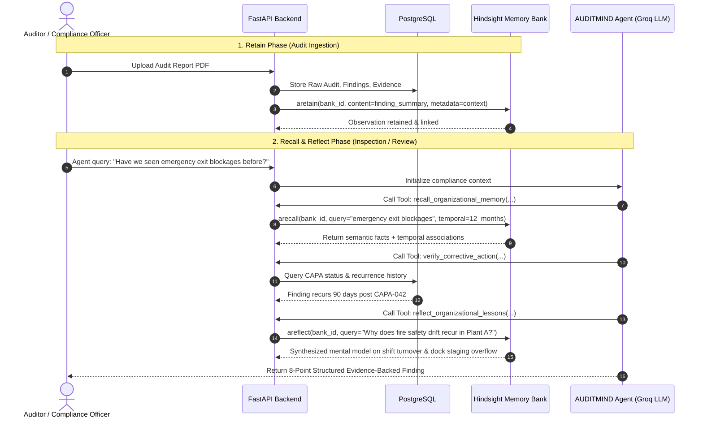

# HINDSIGHT Memory Architecture in AUDITMIND

## 1. Hindsight Integration Overview

Vectorize Hindsight provides persistent, long-term learning capabilities for AI agents. Rather than treating memory as an ephemeral chat session or a brute-force vector search dump, Hindsight creates structured, evolving cognitive layers:
- **Raw Observations / Experiential Facts**
- **Consolidated Beliefs & Observations**
- **Dynamic Mental Models**

---

## 2. Organization-Scoped Memory Banks

Each tenant organization in AUDITMIND is allocated an isolated memory bank in Hindsight:
- Format: `auditmind-org-{organization_id}` or `auditmind-meridian-prod`
- Scoping rule: Cross-bank queries are prohibited at the SDK client layer.
- Retain hashing: Every ingested audit and finding is tagged with an idempotent source reference hash (`sha256(audit_number + finding_code + version)`), ensuring zero duplicated memories on re-runs.

---

## 3. The Core Memory Triad (`retain`, `recall`, `reflect`)



---

## 4. Mental Models Implemented

AUDITMIND configures and queries six specific compliance mental models:

1. **Organizational Compliance Profile**:
   - Synthesizes enterprise-wide compliance posture, audit cadence, maturity level, and systemic trends across all facilities.
2. **Recurring Compliance Failures**:
   - Maintains an evolving map of non-conformances that reappear over 30, 60, 90, or 180-day intervals, tracking failure modes across locations.
3. **Facility-Level Weaknesses**:
   - Isolates specific risk vectors per facility (e.g., Plant A machinery maintenance bottlenecks vs. Warehouse B seasonal contractor onboarding).
4. **Corrective-Action Effectiveness**:
   - Explicitly records whether past CAPAs permanently mitigated the root cause or merely produced superficial checklist sign-offs.
5. **Emerging Operational Risks**:
   - Detects leading indicators of compliance failure before formal audit notices are issued.
6. **Organizational Lessons Learned**:
   - Distills operational wisdom and engineering controls that successfully eradicated compliance risks.

---

## 5. Asynchronous FastAPI Integration Pattern

To avoid event loop blocking, all Hindsight operations inside FastAPI leverage asynchronous client bindings:

```python
from hindsight_client import Hindsight

client = Hindsight(
    base_url=settings.HINDSIGHT_API_URL,
    api_key=settings.HINDSIGHT_API_KEY
)

# Ingestion
await client.aretain(
    bank_id=f"auditmind-org-{org_id}",
    content=f"Audit {audit.audit_number}: Finding {finding.finding_code} - {finding.description}"
)

# Retrieval
memories = await client.arecall(
    bank_id=f"auditmind-org-{org_id}",
    query="machine guarding and interlock switches"
)

# Cognitive Reasoning
synthesis = await client.areflect(
    bank_id=f"auditmind-org-{org_id}",
    query="Assess corrective action durability for machine guarding in Plant A"
)
```
