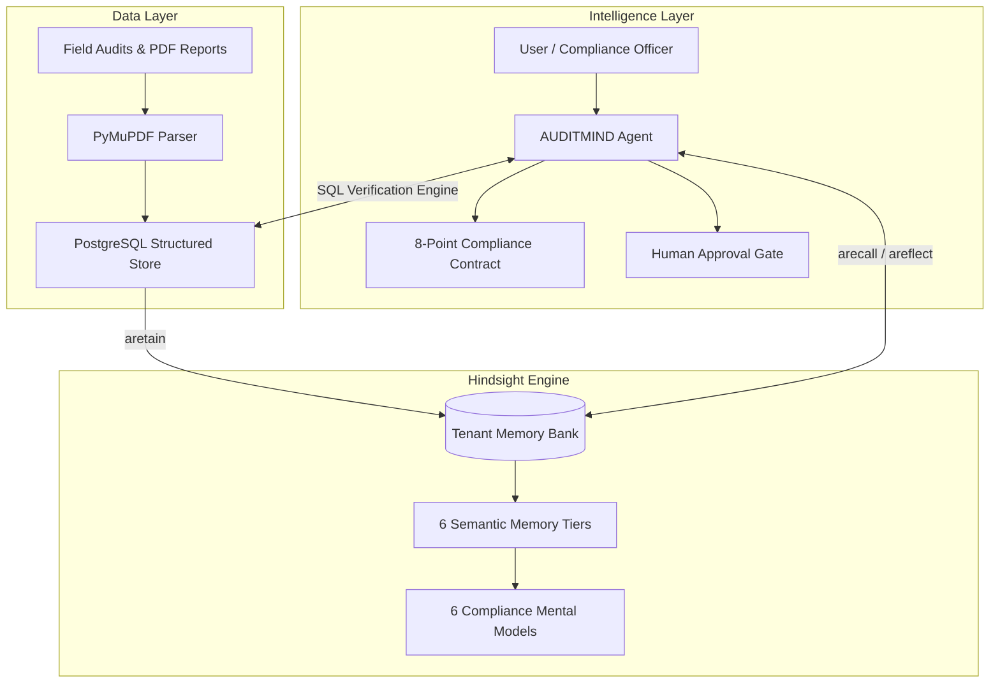

# AUDITMIND — Problem Statement Analysis & Hackathon Alignment

## 1. Challenge & Category Selection

- **Challenge**: HackwithHyderabad 3.0 / Vectorize Hindsight Hackathon
- **Official Theme**: *AI Agents That Learn Using Hindsight*
- **Selected Track / Category**: **Compliance & Audit Agent** (Operations, Quality & EHS)
- **Benchmark Customer Profile**: Multi-site manufacturing enterprises, warehouses, and logistics operators (e.g. *Meridian Industrial Group*).

---

## 2. Core Problem Formulation

### The Fragmented Compliance Reality
Enterprises operating across multiple industrial facilities conduct regular internal, regulatory (OSHA, EPA, ISO), and third-party safety audits. Their historical reports, findings, photos, corrective action plans (CAPAs), and post-remediation verifications are fragmented across siloed PDF documents, disconnected site spreadsheets, and ticket trackers.

### The Critical Flaw: "Completed ≠ Effective"
Standard compliance tools treat compliance as an administrative checklist:
1. An inspector identifies an obstructed fire door or missing machine guard.
2. A plant supervisor issues a reminder memo or conducts a quick retraining session.
3. The supervisor marks the CAPA as "Completed" in the system.
4. The ticket closes.

**The Reality**: A completed corrective action is frequently ineffective. Months later, during peak shipping or production rushes, the exact same hazard returns—either at the same site or across other company facilities. Stateless LLM agents fail here because they treat every uploaded report as an isolated snapshot without historical memory.

---

## 3. How AUDITMIND Solves the Problem with Hindsight Memory

AUDITMIND bridges structured PostgreSQL business records with persistent organizational memory banks powered by the **Hindsight Python SDK**:

### The 6 Cognitive Mental Models
1. **Organizational Compliance Profile**: Synthesizes cross-facility safety culture, aggregate compliance trajectory, and management responsiveness.
2. **Recurring Compliance Failures**: Surfaces chronic systemic hazards (e.g. emergency exit blockages during quarter-end surges).
3. **Facility-Level Weaknesses**: Highlights site-specific vulnerability profiles across stamping, hazmat storage, cleanrooms, and fulfillment lines.
4. **Corrective-Action Effectiveness**: Computes durability rates across procedural retraining vs. engineered physical controls.
5. **Emerging Operational Risks**: Detects leading compliance drift indicators before an OSHA citation occurs.
6. **Organizational Lessons Learned**: Codifies institutional memory of validated engineering remedies.

---

## 4. Alignment with Official Judging Weights

| Judging Dimension | Weight | Hackathon Evaluation Focus | AUDITMIND Architectural Answer |
|---|---|---|---|
| **Innovation** | **30%** | Fresh take on a real problem; beyond obvious chatbots. | **The Central Innovation: Completed ≠ Effective.** A deterministic 90-day observation window evaluates genuine durability; memory elevates recurring failures from procedural memos to engineered physical barriers. |
| **Use of Hindsight Memory** | **25%** | Memory central to value proposition; agent clearly improves over time. | Real async `aretain`, `arecall`, and `areflect` calls; SHA-256 event idempotency; 6 memory categories; 6 persistent mental models; isolated multi-tenant banks. |
| **Technical Implementation** | **20%** | Clean, well-architected, functional code; handles edge cases. | Next.js 14 App Router + FastAPI + SQLAlchemy 2.0 (async) + PyMuPDF + Groq tool-calling. **32/32 passing tests**, zero hallucinated metric cards. |
| **User Experience** | **15%** | Intuitive interface; compelling demo storytelling flow. | Enterprise dark theme, Recharts 12-month drift visualizations, live CAPA verification triggers, PDF upload modal, evidence drawer with SHA-256 hashes. |
| **Real-world Impact** | **10%** | Solves genuine business problem; commercial willingness to pay. | OSHA serious violation penalties reach \$16,131 per violation (willful/repeat violations reach \$161,323). Eliminating recurring citations saves enterprise manufacturers tens of thousands annually. |

---

## 5. Commercial Viability & Target Audience

- **Target Customers**:
  - Industrial manufacturing plants (automotive, machining, electronics).
  - Logistics, warehousing, and e-commerce fulfillment hubs.
  - EHS (Environmental Health and Safety) compliance directors.
- **Willingness to Pay**:
  - The problem statement asks: *"Would someone pay $50/month for this?"*
  - In enterprise EHS, mid-sized enterprises routinely allocate **\$1,000–\$5,000/month** for compliance management platforms (e.g. VelocityEHS, Enablon, Cority).
  - AUDITMIND's capability to prevent repeat citations directly mitigates severe regulatory fines and catastrophic liability.

---

## 6. Storytelling Demo Narrative (3-Minute Flow)

1. **The Hook (0:00–0:30)**: Introduce Meridian Industrial Group (5 facilities, 40 audits, 120 findings). Show how traditional compliance teams drown in repeat violations.
2. **The Problem (0:30–1:00)**: Machine guarding bypass at Plant A. Operator retraining CAPA was completed, but the failure recurred 42 days later. Stateless AI chatbots recommend retraining again.
3. **The Solution (1:00–2:30)**:
   - Live durability verification deterministically catches the recurrence (`FAILED_RECURRED`).
   - Hindsight memory explorer reveals cross-facility pattern synthesis.
   - AUDITMIND AI Agent refuses to recommend another memo and prescribes an engineered interlock, held behind a human executive approval gate.
4. **The Takeaway (2:30–3:00)**: Memory transforms compliance from retroactive paperwork into a proactive operational immune system.
