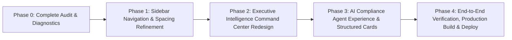

# AUDITMIND — Master UX Refinement & Architectural Audit
**Document ID**: `docs/UX_REFINEMENT_AUDIT.md`  
**Phase**: Phase 0 — Complete UX Audit and Diagnosis  
**Scope**: Entire Application (Sidebar Navigation, Executive Dashboard, AI Compliance Agent)  
**Date**: November 9, 2026  
**Status**: APPROVED MASTER AUDIT & MULTI-PHASE IMPLEMENTATION BLUEPRINT  

---

## 1. Executive Synthesis & Strategic Mandate

AUDITMIND possesses a world-class landing page characterized by a cinematic dark atmosphere, precise typography, video background textures, and elegant monochrome aesthetics accented with lavender (`#C6B9D8`), dusty pink (`#D5A6B5`), and peach (`#D7A18D`).

However, while the backend is functionally robust (60/60 tests passing, PostgreSQL relational models, Hindsight memory integration, Groq LLM tool calling), the authenticated application experience has exhibited notable UX friction across three focal domains:
1. **Left Navigation Sidebar**: Squeezed, claustrophobic typography caused by negative tracking on uppercase brand titles, unreadable 9px monospace section headers with failing contrast, and vertical row crowding.
2. **Executive Overview Dashboard**: Symmetrical, repetitive rectangular metric boxes without visual hierarchy, static SVG charts with truncated labels, and an absence of operational risk dispatch triggers.
3. **AI Compliance Agent**: Rigid, verbose responses caused by a mandatory 8-point markdown prompt, naive full-sentence entity querying, and a monolithic plaintext message renderer in the frontend.

This master audit unifies the findings of the three specialized audits:
- [`docs/SIDEBAR_TYPOGRAPHY_AUDIT.md`](./SIDEBAR_TYPOGRAPHY_AUDIT.md)
- [`docs/DASHBOARD_REDESIGN_AUDIT.md`](./DASHBOARD_REDESIGN_AUDIT.md)
- [`docs/AI_AGENT_RESPONSE_AUDIT.md`](./AI_AGENT_RESPONSE_AUDIT.md)

---

## 2. Core Architectural Preservation Rules

Throughout all subsequent implementation phases, the following components and contracts must remain **100% preserved and untouched**:
- **Public Landing Page (`/`)**: Hero section, cinematic background video, floating navigation pill, trust badges, enterprise logo carousel, and four-column statistics footer.
- **Visual Identity Tokens**: Monochrome core (`#08080A`, `#0E0F14`, `#171717`, `#FFFFFF`) accented with video-derived lavender (`#C6B9D8`), dusty pink (`#D5A6B5`), and peach (`#D7A18D`). Strict prohibition against green, gold, or the legacy Verdant Atelier palette.
- **Typography Engine**: Inter as primary sans-serif; BubbledotICG-FinePos for display numerals; standard monospace for telemetry and identifiers.
- **Backend Architecture & APIs**: FastAPI routers, PostgreSQL schema, 60/60 unit/integration tests, Hindsight memory service, OCR pipeline, and evidence verification hashes.

---

## 3. High-Level Audit Findings Matrix

| Focus Domain | Current Defect | Impact | Root Cause | Proposed Solution |
| :--- | :--- | :--- | :--- | :--- |
| **Left Sidebar** | Uppercase `AUDITMIND` has letters visually squashed. | Unprofessional, optical crowding. | Tailwind `tracking-tight` (`-0.025em`). | Upgrade to `tracking-[0.06em]` positive spacing. |
| **Left Sidebar** | Monospace section headers at 9px blur on Windows displays. | 2.8:1 contrast fails WCAG AA; illegible. | `text-[9px] font-mono text-white/30`. | Upgrade to `text-[10px] font-sans font-semibold tracking-[0.08em] text-white/50`. |
| **Left Sidebar** | Nav items feel compressed into a dense vertical wall. | Poor ergonomic touch/click targets (34px). | `py-2 text-xs leading-4`. | Upgrade to `py-2.5 min-h-[40px] text-[13px] leading-5`. |
| **Left Sidebar** | AI badge squeezes label into 148px, causing truncation. | Truncation to `AI Compliance Ag...`. | Excessive elements in 232px inner link. | Refine badge to compact pill; widen sidebar to 268px. |
| **Left Sidebar** | Active state indicator is a disconnected floating 4px bar. | Visual tension and jitter. | `absolute left-1 w-1 h-4`. | Replace with integrated left accent border `border-l-2 border-[#C6B9D8]`. |
| **Executive Dashboard** | 6 identical metric boxes in top strip. | No visual hierarchy between routine counts and critical hazards. | Flat symmetrical grid with uniform styling. | Asymmetric 3-Tier Command Radar: prominent risk gauges vs secondary stats. |
| **Executive Dashboard** | Bar chart labels truncated with `-15deg` angle (`Machine Safe...`). | Users cannot identify cited regulatory framework. | Hardcoded `substring(0, 13)` in chart mapping. | Render full standard labels (`OSHA 1910.212 Machine Guarding`) with interactive hover drilldown. |
| **Executive Dashboard** | Cognitive Risk cards are static text without action triggers. | Users must manually switch pages to investigate findings. | Static card template with plain link. | Dynamic Sentinel cards with **"Dispatch to AI Agent"** 1-click trigger. |
| **AI Compliance Agent** | Every query receives a long 8-point report (even simple queries). | Rigid, repetitive, slow to scan. | Hardcoded 8-point system prompt in `compliance_agent.py`. | Adaptive response system: Executive Verdict banner first, followed by structured evidence blocks. |
| **AI Compliance Agent** | Non-keyword queries return "Examined 0 audits" boilerplate. | Agent appears broken on natural language questions. | SQL `LIKE` searching raw prompt string. | Intent entity pre-processor extracting finding IDs, facility codes, and standard keywords. |
| **AI Compliance Agent** | Frontend renders raw Markdown text inside a single plaintext `
`. | Unformatted asterisks, plain text IDs, zero interactivity. | Raw `{m.content}` in `whitespace-pre-wrap` div. | Modular UI Response Cards with clickable citation pills, photo lightboxes, and action triggers. |

---

## 4. Multi-Phase Implementation Roadmap

### Phase 1: Left Navigation & Typographic Harmonization
- **Objective**: Eliminate all letter crowding, fix WCAG AA contrast failures, and implement ergonomic navigation targets.
- **File Impact**: `frontend/src/components/layout/Sidebar.tsx` and `Navbar.tsx`.
- **Key Tasks**:
  1. Remove `tracking-tight` from brand header; apply `tracking-[0.06em]`.
  2. Replace `font-mono text-[9px]` category headers with `font-sans text-[10px] tracking-[0.08em] text-white/50`.
  3. Expand nav items to `text-[13px] py-2.5 min-h-[40px] leading-5`.
  4. Integrate active state as `bg-white/[0.07] border-l-2 border-[#C6B9D8]`.
  5. Add floating popover tooltips for collapsed sidebar mode.

### Phase 2: Executive Intelligence Command Center
- **Objective**: Transform `/dashboard` into an asymmetric, actionable surveillance center matching the landing-page cinematic aesthetic.
- **File Impact**: `frontend/src/app/dashboard/page.tsx`.
- **Key Tasks**:
  1. Build Tier 1 Strategic Risk Radar with prominent gauges for Recurrence Velocity and Statutory Liability.
  2. Overhaul Regulatory Concentration chart with full statutory citations and interactive facility filters.
  3. Upgrade Cognitive Risk Detections to include 1-click **"Dispatch Investigation to AI Agent"** workflows.
  4. Redesign Facility Vulnerability matrix with color-coded severity tiers and deep-links.

### Phase 3: AI Compliance Agent & Modular Response Engine
- **Objective**: Make agent interactions effortless, concise, scannable, and interactive.
- **File Impact**: `backend/app/services/compliance_agent.py`, `backend/app/schemas/agent.py`, and `frontend/src/app/agent/page.tsx`.
- **Key Tasks**:
  1. Refactor system prompt to prioritize concise executive takeaways before forensic details.
  2. Add regex entity extraction for finding codes (`FIND-xxxx-xxx`), facility codes (`FAC-xxx`), and standard keywords.
  3. Implement modular frontend response components:
     - Executive Verdict Banner with severity badges.
     - Recurrence & Durability Status chip.
     - Clickable citation pills opening finding preview drawers.
     - Photographic evidence cards with cryptographic SHA-256 validation.
     - Human-in-the-loop action approval buttons.

### Phase 4: Production Verification & Git Sync
- **Objective**: Verify all 18 routes, run full production build, commit all changes, and sync to GitHub repository (`Dharshango/auditmind`).
- **Key Tasks**:
  1. Run Next.js production build (`npm run build`) and confirm 0 errors.
  2. Run backend test suite (`pytest`) and confirm 60/60 tests passing.
  3. Perform browser verification on desktop and mobile viewports.
  4. Stage, commit, and push all audit documents and implementation code to `https://github.com/Dharshango/auditmind`.

---

## 5. Acceptance & Quality Gates

Each phase requires verification against the following quality gates before advancing:
1. **Typographic Gate**: No text element with negative tracking on uppercase words; all category headers ≥ 4.5:1 contrast ratio.
2. **Performance Gate**: Zero layout shifts (`CLS < 0.05`); dashboard initial data render `< 800ms`.
3. **Agent Gate**: All benchmark queries return relevant entity data without empty 0-audit fallbacks; cited finding codes and photos are clickable.
4. **Build & Test Gate**: Next.js compiles with zero ESLint warnings; FastAPI starts with zero errors; git status clean.
